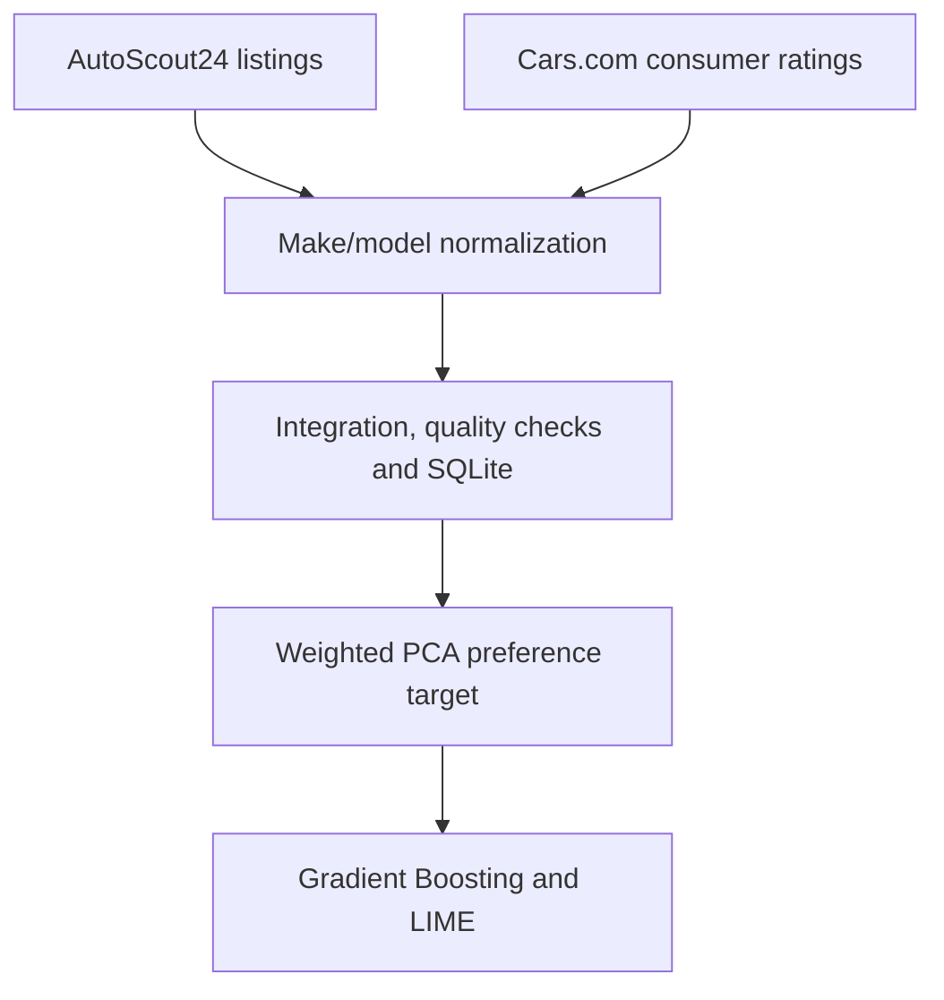

# Used Car Export: Data Integration and Market Analysis

**Combining European used-car listings with U.S. consumer ratings to explore potential export opportunities.**

## Overview

This project integrates European used-car supply data from **AutoScout24** with U.S. consumer ratings from **Cars.com**. Its purpose is to identify vehicles whose specifications and equipment align with stronger consumer preference signals in the U.S. dataset.

The pipeline combines web scraping, data cleaning, schema harmonization, quality assessment, relational storage and machine learning.

The resulting integrated dataset contains **1,507 listings**, covering **239 make/model combinations** associated with U.S. consumer reviews.

The full methodology and results are documented in the [project report](report/project_report.pdf).

## Tools and technologies

| Technology | Role |
|---|---|
| **Python and Jupyter** | Data collection, integration and analysis |
| **requests and Beautiful Soup** | Collection of European listings and vehicle details |
| **Selenium** | Collection of U.S. consumer ratings |
| **SQLite** | Storage and SQL-based inspection of the integrated data |
| **scikit-learn** | Gradient Boosting classification, hyperparameter tuning and evaluation |
| **LIME** | Interpretation of model predictions |

## Pipeline

The project is organized into three notebooks that cover data collection and the subsequent integration and analysis.



The main processing stages are:

1. Collect European used-car listings and their technical specifications.
2. Retrieve U.S. consumer ratings at make/model level.
3. Standardize make and model names across both sources.
4. Join the datasets and assess completeness and identifier uniqueness.
5. Store the integrated table in SQLite.
6. Construct a preference proxy from consumer ratings using weighted PCA.
7. Train and tune a Gradient Boosting classifier.
8. Examine feature importance and LIME explanations.

## Data collection and integration

The data snapshot was collected on **29 December 2025**.

| Processing stage | Count |
|---|---:|
| AutoScout24 listings after deduplication | 3,633 |
| Listings with parsed technical information | 3,532 |
| Integrated listings | 1,507 |
| Matched make/model combinations with reviews | 239 |
| Columns in the SQLite table | 174 |
| Records used for machine learning | 1,486 |

The sources are connected through normalized make/model keys. An **inner join** retains only European listings with a matching U.S. consumer-rating profile.

## Database and data quality

The integrated dataset is stored in the SQLite table **`cars_data`**.

It brings together:

- Listing identifiers and prices.
- Vehicle specifications.
- Binary equipment indicators.
- Six consumer-rating dimensions.
- Review counts.

The database structure is documented in [`database/schema.sql`](database/schema.sql). Two SQL validation examples are available in [`database/queries.sql`](database/queries.sql).

| Quality measure | Result |
|---|---:|
| Overall completeness | 98.85% |
| Identifier uniqueness | 99.8% |
| Duplicated identifiers | 3 |


## Constructing the preference target

The analysis uses six Cars.com rating dimensions:

- Comfort.
- Interior.
- Performance.
- Value.
- Exterior.
- Reliability.

These dimensions are summarized using **weighted Principal Component Analysis**, with review volume used as the observation weight.

The first principal component is converted into a binary target named **`appreciate`**. Listings with a component score above the sample mean are assigned to the positive class.

This target represents a **rating-based preference proxy**, rather than directly observed purchasing or export demand.

## Classification and evaluation

A **Gradient Boosting classifier** predicts the `appreciate` target from vehicle specifications and equipment features.

Hyperparameter selection uses **five-fold GridSearchCV**, with **ROC AUC** as the optimization metric.

| Metric | Baseline model | Tuned model |
|---|---:|---:|
| Accuracy | 0.8020 | **0.8322** |
| Precision | 0.7576 | **0.7830** |
| Recall | 0.6818 | **0.7545** |
| F1 score | 0.7177 | **0.7685** |
| ROC AUC | 0.8571 | **0.8838** |

The best mean cross-validation ROC AUC was **0.8624**. The tuned model improved all reported metrics on the held-out test set compared with the baseline.


## Interpreting the results

The analysis combines the classifier's native feature importance with aggregated **LIME** explanations.

Both methods highlight **body type, power and engine size** as relevant predictors. In the submitted analysis, convertible configurations have the strongest positive directional contribution, while electric fuel type has the strongest negative contribution to the constructed preference proxy.

These findings describe the fitted model and the collected data snapshot. They do not establish causal relationships or represent the entire U.S. vehicle market.


## Repository contents

| Path | Description |
|---|---|
| `assets/` | Analytical figures used in the README |
| `data/README.md` | Data availability and expected pipeline files |
| `database/schema.sql` | Schema of the submitted SQLite table |
| `database/queries.sql` | SQL validation examples |
| `notebooks/01_autoscout24_collection.ipynb` | European listing and technical-detail collection |
| `notebooks/02_carscom_reviews_collection.ipynb` | U.S. consumer-rating collection |
| `notebooks/03_data_integration_and_analysis.ipynb` | Integration, quality assessment and machine learning |
| `report/project_report.pdf` | Full academic report |
| `requirements.txt` | Python dependencies |
| `.gitignore` | Files excluded from version control |
| `README.md` | Project overview and execution notes |

Raw records, processed datasets, the populated SQLite database, execution logs and checkpoints are not redistributed in this public repository.

Additional information is available in [`data/README.md`](data/README.md).

## Environment setup

Create a virtual environment:

```bash
python -m venv .venv
```

Activate it on macOS or Linux:

```bash
source .venv/bin/activate
```

On Windows, using Command Prompt:

```bat
.venv\Scripts\activate
```

Install the dependencies and start Jupyter:

```bash
python -m pip install -r requirements.txt
jupyter notebook
```

## Notebook execution

The notebooks use different execution environments:

| Notebook | Environment and file locations |
|---|---|
| AutoScout24 collection | Developed in Google Colab; saves outputs to `DataManagement_Project/` in Google Drive |
| Cars.com collection | Uses a local Chrome installation; saves outputs in local `data/`, `logs/` and `checkpoints/` directories |
| Integration and analysis | Run from the repository root once the required source files are available in `data/` |

Review the input and output paths before execution and adapt them to your environment.

The collection notebooks document the academic workflow. Before rerunning them, verify the source websites' current terms of use, `robots.txt` directives and access requirements.

## Publication notes

The notebook source code and reported analytical results are preserved. Before publication, stored raw-record previews, collection logs and verbose cross-validation traces were removed from notebook outputs.

The report and retained analytical outputs allow the methodology and submitted results to be reviewed without redistributing the underlying records.

## Limitations

- **Preference proxy:** `appreciate` is derived from consumer ratings and does not measure actual U.S. purchases or export demand.
- **Export feasibility:** regulatory requirements and vehicle conversion costs are outside the scope of the analysis.
- **Time coverage:** European listings represent a single-day snapshot and do not capture changes in inventory or prices.
- **Matching coverage:** integration depends on consistent make/model identification and the availability of U.S. reviews.

## Authors

Developed collaboratively by:

- [Davide Francesco Caramia](https://github.com/davidecaramia)
- [Nicolò Bachiorri](https://github.com/nicolobachiorri)
- [Hervé Mottaran](https://github.com/hervemottaran)

**Data Management — Università degli Studi di Milano-Bicocca**  
**Academic Year 2025/2026**
